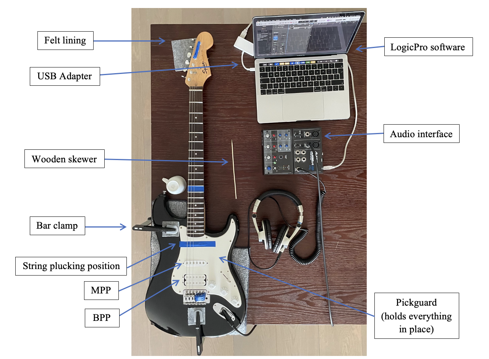
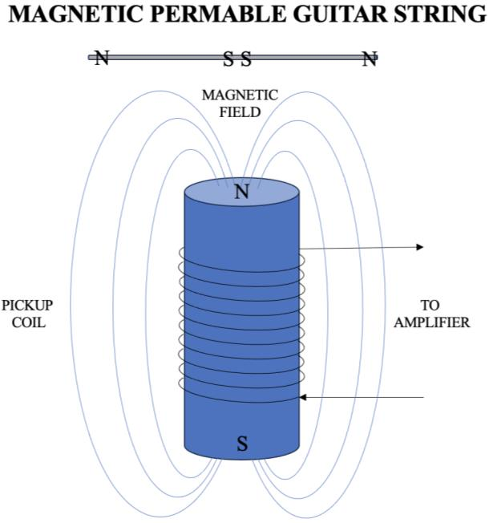
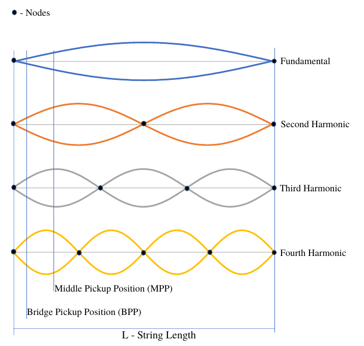
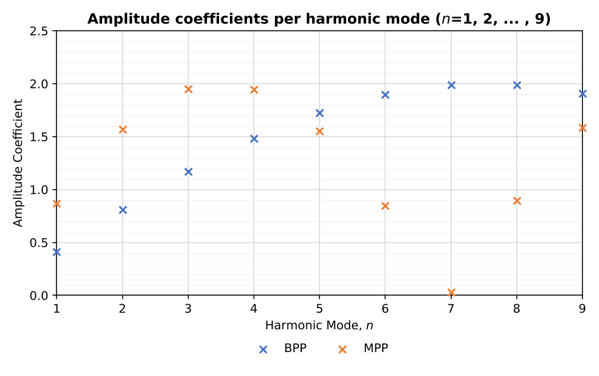
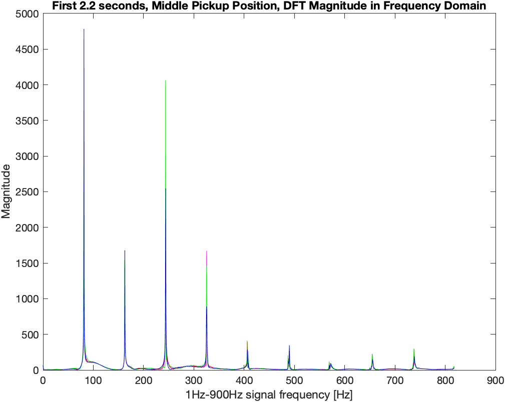
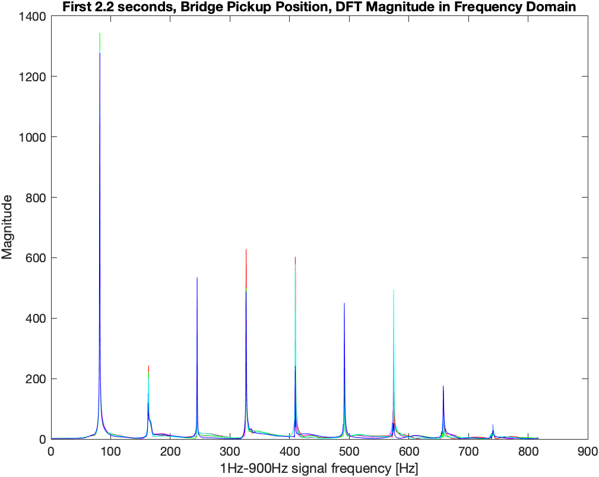
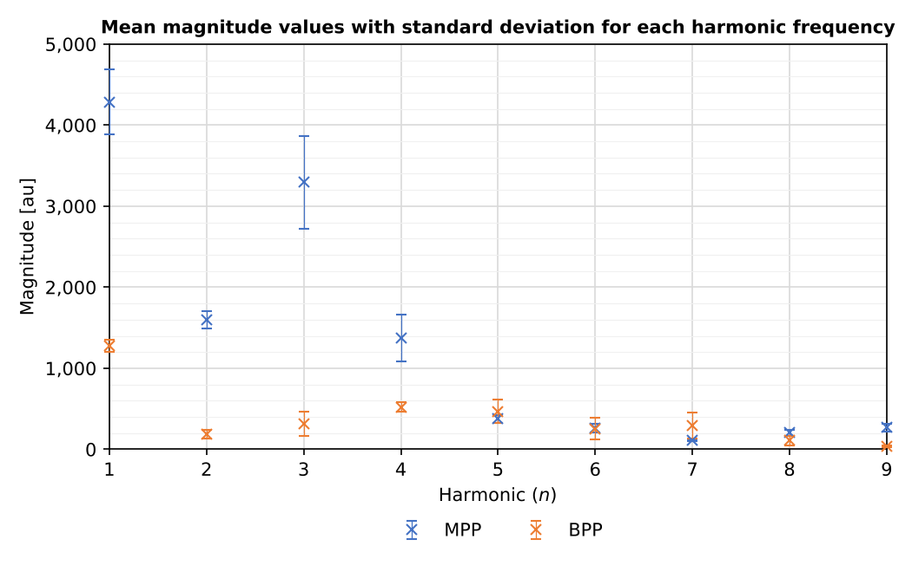
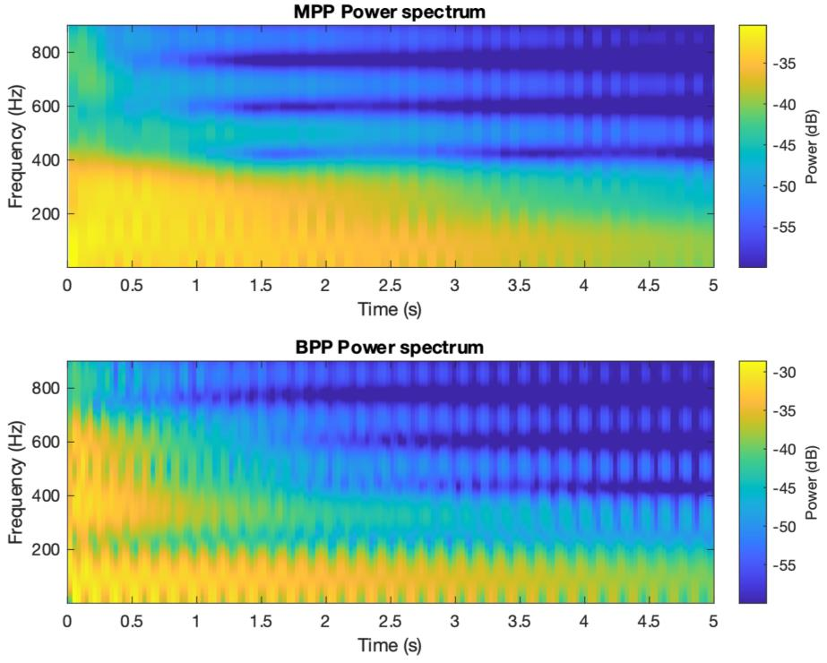
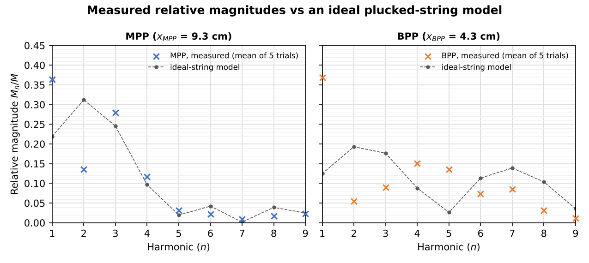

# The Influence of Electric Guitar Pickup Placement on Sound Brightness

**Research question:** How does the placement of a single-coil guitar pickup influence the brightness of the sound of the E2 note produced on a Fender Squier Stratocaster guitar?

I investigated this for my IB Physics Extended Essay (2023). The single-coil pickup was tested in two positions:

- **MPP**, the Middle Pickup Position, 9.3 cm from the bridge.
- **BPP**, the Bridge Pickup Position, 4.3 cm from the bridge.

At each position I recorded five plucks of the E2 string. The harmonics were analysed with the Digital Fourier Transform (DFT), and brightness was quantified with the Spectral Centroid and the Tristimulus-based Brightness Ratio.

**Hypothesis:** the closer the pickup is to the bridge, the brighter the sound, because upper harmonics are stronger relative to the fundamental and lower harmonics.

**Result:** supported. In the first 2.2 s of the note:

- The BPP's Spectral Centroid *C*ₜ is 1.3× the MPP's.
- Its Brightness Ratio *R*_b is about 3× the MPP's.
- Its Modified Brightness Ratio *R*_mb is about 4× the MPP's.
- A significance test added in 2026 gives p < 0.001 for all three.

This repo is a 2026 refresh. The original MATLAB analysis is rewritten as a tested Python module, rerun on the essay's data, and extended with a significance test and an ideal-string model. Figure, graph, table and equation numbers below refer to the essay.


*Figure 4 — Experimental set up. The guitar is stabilised with bar clamps, and the string is raised 1 cm with a wooden skewer at the plucking position (blue tape). The signal is recorded through an Alesis Multimix 4 USB FX audio interface into Logic Pro at 44,100 Hz.*

## Theory

| | |
|---|---|
|  |  |
| *Figure 1 — emf induction in the pickup coil* | *Figure 2 — Nodes and antinodes of the first 4 harmonics relative to the BPP and MPP* |

1. **Magnetic induction (Equations 1–4).** By Faraday's law, the emf ε(*t*) induced in the pickup coil is proportional to the velocity *v*(*t*) of the string above it.
2. **Standing waves (Equations 5–8).** The string vibrates as a superposition of harmonics *n* = 1, 2, 3, …. The velocity of harmonic *n* at position *x* is −2*A*ₙωₙ sin(*nπx*/*L*) sin(ωₙ*t*).
3. **Amplitude Coefficient (Equation 9, Table 2).** At peak velocity, each harmonic is weighted by 2|sin(*nπx*/*L*)|. A pickup at a **node** of harmonic *n* doesn't register it. A pickup at an **antinode** registers it at maximum.


*Graph 1 — Comparison of amplitude coefficients for each harmonic mode. Harmonics 1–4 are sensed more strongly at the MPP, and harmonics 5–9 at the BPP. The MPP sits 0.04 cm from a node of harmonic 7 (Table 1), so it should barely register it.*

## Data analysis

| | |
|---|---|
|  |  |
| *Graph 4 — DFT-obtained frequencies of 2.2 s of signal for the MPP (5 trials)* | *Graph 5 — DFT-obtained frequencies of signal for the BPP (5 trials)* |


*Graph 6 — Mean magnitude of each harmonic frequency for both pickup positions, with standard deviation over 5 trials (Tables 3–4). As predicted, harmonic 7 is barely registered at the MPP, while harmonics 6–7 are clearly present at the BPP.*


*Graph 7 — Power spectrum for the MPP and BPP, 1–900 Hz. Red boxes mark the first 2.2 s (Attack, Decay and Sustain). The BPP shows more upper harmonics above 400 Hz (harmonics 5–7).*

## Findings

Sound characteristics in the first 2.2 s (Table 5):

| Characteristic | MPP | BPP | Ratio (BPP/MPP) |
|---|---|---|---|
| *C*ₜ – Spectral Centroid [Hz] (Equation 12) | 217.82 | 281.39 | 1.29 |
| *R*_b – Brightness Ratio / Tristimulus (Equation 13) | 0.28 | 0.91 | 3.22 |
| *R*_mb – Modified Brightness Ratio (Equation 14) | 0.12 | 0.51 | 4.39 |

Where *R*_b = (*M*₅ + … + *M*ₙ) / *M*₁ and *R*_mb = (*M*₅ + … + *M*ₙ) / (*M*₁ + … + *M*₄), with *M*ₙ the magnitude of harmonic *n*.

**Added in 2026:** the characteristics are also computed for each trial separately and compared with Welch's t-test. *C*ₜ, *R*_b and *R*_mb are all higher at the BPP with p < 0.001. See [`results/metrics.md`](results/metrics.md).

## Extension (2026): where the ideal model breaks


*Each harmonic's measured share of the total magnitude (Tables 3–4), compared with an ideal plucked string sensed at a single point (Equation 9 combined with the plucking position, 13.6 cm).*

The model gets the overall pattern right for the MPP, including the near-zero harmonic 7. It underestimates the fundamental, and fits the BPP less well. That is expected, for three reasons:

- A real pickup senses a few centimetres of string, not a single point.
- The coil's inductance filters the signal.
- Plucking by hand varies between trials, which is limitation 3 in the essay's Evaluation.

## Run it

```bash
pip install -r requirements.txt
python reproduce.py          # regenerates Graph 1, Graph 6, the extension figure and results/metrics.md
python -m pytest tests/      # checks the theory and analysis code
```

The original `.wav` recordings weren't kept. `data/harmonic_magnitudes.csv` holds the per-trial harmonic magnitudes from Tables 3–4.

To test the DFT pipeline end to end, `pickup_brightness.synth_pluck()` generates modelled plucks for any pickup position. To analyse a real guitar, point `harmonic_magnitudes()` at your own recordings.

## Repo layout

```
src/pickup_brightness.py     theory (Eq. 6, 7, 9), DFT harmonic extraction, C_t, R_b, R_mb (Eq. 12–14), string synthesis
reproduce.py                 rebuilds Graph 1, Graph 6, the extension figure and results/metrics.md
figures/original_2023/       Figures 1, 2, 4 and Graphs 4, 5, 7 from the essay
data/                        Tables 3–4: per-trial harmonic magnitudes
results/metrics.md           Table 5 reproduced, plus significance tests
tests/                       unit tests, including a check against Table 2
original_matlab/             the 2023 MATLAB script from the essay Appendix, unchanged
```

## Notes

- *C*ₜ here uses nominal harmonic frequencies (*n* × 82.41 Hz). The essay used each peak's measured frequency, so values differ from Table 5 by about 1%.
- The original MATLAB script has a copy-paste slip: trial 4's fundamental search reads trial 3's spectrum (`absDFT(3, ...)`). The Python rewrite replaces the unrolled loops, which removes that class of bug.
- Colours match each graph in the essay. Graph 1 shows BPP in blue, while Graph 6 shows MPP in blue.

## Context

This started as an IB Diploma Physics Extended Essay (May 2024 session, submitted November 2023). The full write-up is not reproduced here.

## License

Code is licensed under MIT (see [LICENSE](LICENSE)). Figures and text are licensed under CC BY-NC 4.0.
